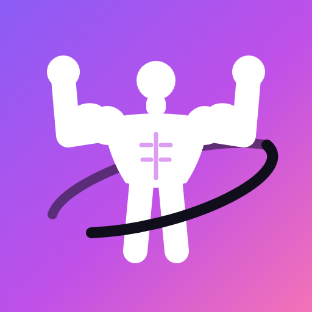

<div align="center">



# Mfit

**Entrena con cabeza, come con números.**

App móvil de rutina de gimnasio, progreso y nutrición. Se instala en el iPhone y funciona sin conexión.


</div>

---

> 🧪 **En base beta.** Funciona y se usa a diario, pero de momento es sobre todo para uso propio: puede cambiar cualquier cosa.

## 💪 De qué va esto

Mfit te monta la rutina según el **volumen de entrenamiento** que te toca (no con ejercicios fijos), te dice en cada ejercicio si subir, mantener o bajar peso, y lleva tu nutrición: calorías, macros, % de grasa y diario de comidas.

Está hecha a mano: HTML, CSS y JavaScript, sin compilación. Los datos se guardan en el propio móvil y no salen de ahí.

## ✨ Lo más chulo

- **Rutina por volumen.** Eliges nivel, días y objetivo, y reparte las series semanales por músculo (división Full Body, Torso/Pierna o PPL según los días).
- **Te dice qué peso poner.** Doble progresión: si haces todas las series al tope del rango, sube; si fallas dos sesiones seguidas, baja un 10 %. Cada ejercicio lleva su ▲ ＝ ▼.
- **Registro de series en el gimnasio** con última marca, consejos de técnica, series de calentamiento calculadas y temporizador de descanso.
- **Progreso de verdad.** Resumen semanal y mensual comparado con el periodo anterior, 1RM estimado, gráficas, peso corporal y % de grasa por medidas.
- **Nutrición completa.** Calorías y macros según tu perfil, diario de comidas con ~60 alimentos y los tuyos propios, y aviso si el ritmo de cambio de peso no cuadra.
- **App de iPhone con Capacitor.** Vibra al marcar series y te avisa al terminar el descanso aunque tengas el móvil bloqueado.
- **Funciona sin conexión** y nada sale del móvil: base de datos interna (IndexedDB) con copia de seguridad exportable.

## 🗂️ Estructura

```
├── index.html            → estructura y barra de pestañas
├── css/styles.css        → diseño (tema oscuro, mobile first)
├── js/
│   ├── data.js           → músculos, ejercicios con técnica, volumen y divisiones
│   ├── foods.js          → base de alimentos y comidas del día
│   ├── db.js             → base de datos interna (IndexedDB)
│   ├── calc.js           → nutrición, progresión, generador y estadísticas
│   ├── store.js          → estado y guardado
│   ├── charts.js         → gráficas SVG
│   ├── native.js         → funciones del iPhone (vibración, avisos)
│   └── app.js            → pantallas y acciones
├── scripts/              → build-www.mjs e ios-setup.mjs (app nativa)
├── capacitor.config.json → configuración de la app de iPhone
├── sw.js                 → modo sin conexión (sube VERSION al publicar)
└── manifest.webmanifest  → datos para instalarla como app
```

## 🛠️ Cómo tocarla

**Verla en local:**
```bash
cd ~/"m3 way/Mfit"
python3 -m http.server 8000
```
Y abre `http://localhost:8000` en Chrome (`Cmd+Opt+I` → icono de móvil para verla en tamaño teléfono).

**Cambiar el volumen recomendado:** `VOLUME` en `js/data.js`. **La progresión y la nutrición:** `js/calc.js`.

## 📱 Ponerla en el iPhone

**Como web app (sin Xcode):** ábrela desde GitHub Pages en Safari → Compartir → *Añadir a pantalla de inicio*.

**Como app nativa (con Xcode 26+ y Node 22+):**
```bash
cd ~/"m3 way/Mfit"
npm install     # la primera vez
npm run ios     # prepara la web, crea el proyecto de Xcode, pone el icono y lo abre
```
En Xcode elige tu iPhone → *Signing & Capabilities* → *Team* → ▶. Con Apple ID gratis caduca a los 7 días; con la cuenta de desarrollador dura un año. Tras cambiar código: `npm run sync` y ▶.

## 📝 Cambios

- **0.3** — App nativa de iPhone con Capacitor: vibración, aviso de fin de descanso e icono.
- **0.2** — Diario de comidas, plan de cargas, calentamiento, medidas y % de grasa.
- **0.1** — Primera beta: generador por volumen, registro, progresión y nutrición.

---

<div align="center">

Hecha entre serie y serie en Córdoba 🏋️

</div>
